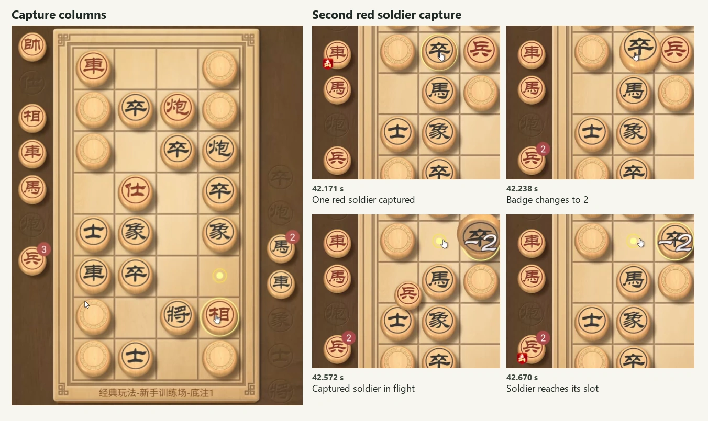

# Banqi 暗棋 variant proposal

Product proposal for LiXiangQi · 24 November 2026

**Launch Banqi as a two-player game on 32 cells, using the Taiwanese competition rules linked by the International Computer Games Association (ICGA).** The first flip assigns the armies. A player wins by taking the opponent’s last piece or leaving the opponent without a legal action. Use one rated live pool, an independent Banqi rank, friend challenges, a browser opponent and an analysis board that lets players study alternative reveals. [ICGA tournament reference](https://icga.org/?page_id=1074) · [Chinese rule sheet, 2014](https://homepage.iis.sinica.edu.tw/~tshsu/tcg/2014/hwks/rules.pdf)

**Adopt Tiantian’s captured-piece display.** Its permanent slots, faint engravings, count badges and brief capture flight let players see how many pieces of each kind have already gone. Its floating deductions, health bars, combos and coin multiplier belong to Fanfanqi’s scoring system. The supplied recording shows both systems operating during the same capture.

## The rules players would learn

1. **Deal and first turn.** Shuffle all 32 pieces together, face down, over four files and eight ranks. Each army has one general, two each of advisor, elephant, chariot, horse and cannon, and five soldiers. Draw the opening seat fairly. Its player flips any cell and takes the colour revealed. The other player moves next, even when the opener drew Black. Every later flip also consumes the entire turn, whoever owns the revealed piece.
2. **Choose one action.** Flip any covered piece in place, move one of your open pieces one cell orthogonally into an empty cell, or capture an open enemy. Directions are the same throughout the board. There is no pass. A surviving covered piece is a possible flip even when you have no open pieces.
3. **Ordinary captures.** From strongest to weakest the order is general, advisor, elephant, chariot, horse, cannon, soldier. An ordinary attacker takes an adjacent enemy of equal or lower rank and occupies its cell. The soldier can take the opposing general or soldier. The general can take every enemy rank except the soldier. Capturing the general removes one piece and play continues while the opponent can still play.
4. **Cannons.** For a quiet move, a cannon steps into an adjacent empty cell. For a capture, it jumps in a straight line over **exactly one occupied cell** to an open enemy of any rank, including another cannon. The screen can be covered or open, friendly or hostile. Empty cells on either side of the screen are fine. An adjacent enemy, a second screen and a covered target each rule out the capture. For example, a cannon on a1 can take an open enemy general on a5 over a cover on a3 if a2 and a4 are empty.
5. **Win and draw.** Losing all 16 pieces loses immediately, even if some enemy pieces are still covered. Otherwise, having no legal action on your turn loses. Draw automatically on the third occurrence of the same position with the same player to move, or after **30 consecutive individual turns** without a capture or flip, 15 turns apiece. Either kind of progress resets the quiet count. For online adjudication, compare visible pieces, covered cells, army assignment and seat to move. Ignore clocks and the quiet counter when comparing positions. Resolve a decisive board result before testing the draw conditions. Apply the site’s resignation, flag and agreed-draw handling.

The 2014 sheet supplies the movement, capture and draw rules. The 2019 revision spells out the useful distinction between losing all your pieces and having none showing. The repetition key and precedence above make those rules reproducible online. [2014 competition rules](https://homepage.iis.sinica.edu.tw/~tshsu/tcg/2014/hwks/rules.pdf) · [2019 Chinese rules](https://homepage.iis.sinica.edu.tw/~tshsu/tcg/2021/hwks/rules.pdf)

### Where competitions and apps differ

| Source                                                                   | What changes in play                                                                                                                                                                                                                                                                                                                                                                                                                                                              |
| ------------------------------------------------------------------------ | --------------------------------------------------------------------------------------------------------------------------------------------------------------------------------------------------------------------------------------------------------------------------------------------------------------------------------------------------------------------------------------------------------------------------------------------------------------------------------- |
| ICGA-linked 2014 rules and National Taiwan University’s 2025 competition | The Chinese sheet specifies 30 quiet plies and a threefold cycle. NTU’s 2025 competition independently specifies 30 plies without a capture or reveal and a 600+0 clock setting. These give the pool a published ruleset and a practical live time control. [ICGA](https://icga.org/?page_id=1074) · [2014 rules](https://homepage.iis.sinica.edu.tw/~tshsu/tcg/2014/hwks/rules.pdf) · [NTU 2025, slides 5–6](https://www.csie.ntu.edu.tw/~tcg/2025/final/problem_file/final.pdf) |
| Tsan-sheng Hsu’s 2019 rule sheet                                         | The same basic game and threefold cycle, with **60** quiet plies. That gives a stronger side more time to convert an ending. The draw threshold needs a published version even among Taiwanese competition rules. [2019 rules](https://homepage.iis.sinica.edu.tw/~tshsu/tcg/2021/hwks/rules.pdf)                                                                                                                                                                                 |
| Mingjian Township national human championship, Nantou, May 2026          | Section 19 requires exposed enemy targets and visible captured pieces. Once the board is fully revealed, a player may request a **25-round** count. A capture restarts it. A seventh repeated chase by one piece against one target can draw a foul, with a stated exception and a referee ruling. Two fouls lose. This is a real alternative for an over-the-board event. [Organizer’s Chinese competition notice, §19](https://www.beclass.com/rid%3D305263a69d8d7bd3878f)      |
| 戲谷暗棋館                                                               | The operator distinguishes standard single captures of open enemies from rooms permitting consecutive captures, covered-piece captures or a long-range chariot. These choices materially change which moves are legal. [Operator’s Chinese rules](https://darkchess.funtown.com.tw/rules2.html)                                                                                                                                                                                   |

For LiXiangQi, the 30-ply rule keeps one recognizable pool and gives players a visible countdown they can verify. A repeating chase resolves through the same repetition rule as any other cycle. This trades some room for endgame manoeuvring for a known competitive limit and avoids asking a server to infer a human referee’s chase judgement. Publish the choice on the rules page and record its version with every game.

## What the Tiantian recording establishes

_The left crop is from the supplied 740 × 1316 screenshot. The four details are from the 608 × 1078 recording, at original video timestamps. They show the board area only._

| Recording time                 | Observation                                                                                                                                                                                                                                                                 | Banqi treatment                                                                                                                                                                                                                                                        |
| ------------------------------ | --------------------------------------------------------------------------------------------------------------------------------------------------------------------------------------------------------------------------------------------------------------------------- | ---------------------------------------------------------------------------------------------------------------------------------------------------------------------------------------------------------------------------------------------------------------------- |
| 0:00 and 0:16–0:17             | Four pieces are already showing in the first frame. Both health bars read 60. A black horse takes a red soldier. The upper-left column gains one solid soldier, “−2” appears at the capture square, and Red goes to 58.                                                     | Start Banqi with all pieces covered. Keep the moving attacker and the victim’s journey to its slot.                                                                                                                                                                    |
| 0:42.17–0:42.67                | Before the capture the soldier slot contains one disc without a numeral. At 42.238 its upper-right badge reads **2**. At 42.572 a separate red soldier is visibly travelling down-left. By 42.670 it has reached the slot. The board shows “−2” and Red goes from 48 to 46. | The round badge counts captured pieces of that colour and role. Update the count on the accepted move, then animate one victim to the fixed destination. The full interaction here is about 0.4–0.5 seconds. The visible free flight occupies only the final fraction. |
| 0:51 and 1:15–1:17             | An on-board tip explicitly says the cannon can hit an unopened piece. Later a black soldier takes the red general, “−30” appears and Red goes from 41 to 11. Play continues.                                                                                                | Keep the soldier–general exception. Use the competition cannon rule and ordinary capture feedback. The 30-point deduction belongs to the health game.                                                                                                                  |
| 1:21–1:26                      | The third red soldier raises its badge to **3** while Red goes from 11 to 9. The second black horse raises its own badge to **2** while Black goes from 50 to 45. The screenshot shows both totals at once.                                                                 | This identifies the badges as cumulative captures, independently of health, capture streak and the number still covered. A general can fill its slot once, a soldier up to five times.                                                                                 |
| About 0:29, 1:12 and 1:36–1:46 | A combo callout and flames, a character portrait, then a zero-health finish and a **−210** coin settlement appear. The settlement includes separate flip, combo and health-difference entries.                                                                              | Use the existing turn indicator, selection, legal targets, last action, capture sound and game result. Omit floating damage, combo effects, character cut-ins, health gauges, stakes and settlement rewards.                                                           |

There is also a **small red square at the lower left** of the most recently captured role in several sequences. At 42.17 it is on the chariot and by 42.67 it is on the soldier. Its exact label or effect is unexplained in the footage. A brief arrival highlight can communicate the latest capture. Only the **round upper-right numeral** should carry a persistent count.

### Dimensions for matching the capture columns

Measurements below use the supplied still at native size, from the top-left corner. A cell pitch **C ≈ 102.5 px** is the distance between adjacent grid lines. Use this as the scaling unit, including when the board resizes on desktop. The visible disc body includes its bevel and excludes the cast shadow.

| Feature                 | Measurement in the reference                                                                                                                              | Target relative to the grid                                                                                                                |
| ----------------------- | --------------------------------------------------------------------------------------------------------------------------------------------------------- | ------------------------------------------------------------------------------------------------------------------------------------------ |
| Board and playing field | Outer wood approximately x 119–625, y 193–1114. Grid approximately x 167–577, y 239–1059.                                                                 | Four square cells across, eight down. Size the board and both columns as one group.                                                        |
| Upper-left column       | Centres at x ≈ 67. Top to bottom, y ≈ 237, 325, 413, 501, 589, 677, 765. Roles are 帥, 仕, 相, 車, 馬, 炮, 兵.                                            | Centre line **0.98 C left** of the playing grid. First centre approximately level with the grid’s top edge. Pitch **0.86 C**.              |
| Lower-right column      | Centres at x ≈ 679. Top to bottom, y ≈ 559, 647, 735, 823, 911, 999, 1087. Roles are 卒, 炮, 馬, 車, 象, 士, 將, using the chosen set’s glyphs.           | Centre line **1.00 C right** of the grid. First centre **3.12 C** below the grid top. Same pitch. The generals occupy opposite ends.       |
| Off-board pieces        | Lit body about **68 × 71 px**, around 17–20 px clear of the outer wood horizontally. Empty slots show an engraved circle and role about **60 px** across. | Body width **0.66 C**, height about **0.69 C**, engraving about **0.58 C**. Measure visible artwork, allowing for transparent SVG padding. |
| Number badge            | About **35–36 px** across. Its centre sits about **28 px right and 28–29 px above** the body centre.                                                      | Diameter **0.35 C**, centre offset **(+0.27 C, −0.28 C)**. Use a muted red disc and a light numeral.                                       |

At zero, show the fixed engraved ring and role against the rail material. At one, show the coloured piece. At two or more, show one piece with its total. All seven slots retain their positions even when empty. In this red-at-bottom view the opponent’s captures occupy the upper left and the local player’s captures the lower right. For LiXiangQi, anchor the stacks to the capturing seats and colour the victims by their own army. The recording establishes only the red-at-bottom orientation. Keep the board steady when the first flip assigns colours.

The head-on reference can support a pixel overlay at this size. Aim for slot centres within **2 px** and visible widths within **3 px**, then check the same ratios on 390, 900 and 1440 px layouts in both themes. Reserve space for the badge at the narrowest width. Use a faint outline compatible with each board material and expose an accessible count such as “Red soldiers captured, 3 of 5.” With reduced motion, update the same slot immediately. Reconnects and replay seeks should restore all counts at the chosen ply without replaying old flights.

## Rating and rank lists

| Chinese-language product                                   | What its published material supports                                                                                                                                                                                                                                                                                                                                                                                                                                                                                                                                                                                        |
| ---------------------------------------------------------- | --------------------------------------------------------------------------------------------------------------------------------------------------------------------------------------------------------------------------------------------------------------------------------------------------------------------------------------------------------------------------------------------------------------------------------------------------------------------------------------------------------------------------------------------------------------------------------------------------------------------------- |
| **天天象棋**, mainland China                               | Tencent lists 象棋, 揭棋 and 翻棋 alongside its assessment feature. An official event guide shows separate profile tabs. The supplied Fanfanqi game settles in coins. Neither the guide nor the publisher listing identifies a Banqi-specific skill formula or promotion table. The familiar 业 and 揭 grades belong to identifiable other tracks. [Tencent’s Chinese listing](https://m.app.mi.com/details?id=com.tencent.qqgame.xq) · [Event organizer’s illustrated guide, pp. 1–2](https://www.sport.gov.cn/n315/n20001395/c23411842/part/23411846.pdf)                                                                 |
| **多乐中国象棋** and **家棋象棋翻棋**, mainland storefront | Duole lists flip play and records its addition alongside a daily first win and streak indicators. Jiaqi’s release notes explicitly advertise a server-wide leaderboard, personal results, win rate and streaks. Neither publishes how a flip result changes a skill rating. [Duole’s listing](https://apps.apple.com/cn/app/%E5%A4%9A%E4%B9%90%E4%B8%AD%E5%9B%BD%E8%B1%A1%E6%A3%8B-%E5%A4%A7%E5%AE%B6%E5%9C%A8%E7%8E%A9%E7%9A%84%E5%A4%9A%E4%B9%90%E8%B1%A1%E6%A3%8B/id1561949343?platform=tv) · [Jiaqi’s release notes](https://apps.apple.com/cn/app/%E5%AE%B6%E6%A3%8B%E8%B1%A1%E6%A3%8B%E7%BF%BB%E6%A3%8B/id6754841084) |
| **戲谷暗棋館**, Taiwan                                     | The operator ranks players by total points. Newcomers start at 新人, with percentile grades 九品 through 一品 and top honours including 棋聖, 棋俠 and 暗棋王. Ranks are recomputed daily. The operator separately lists titles tied to coin wealth. [Operator’s rank table](https://darkchess.funtown.com.tw/intro3.html)                                                                                                                                                                                                                                                                                                  |
| **神來也暗棋2**, Taiwan                                    | The 戰力位階 guide publishes a monthly nine-tier ladder from 卒 to 神. A 100-stake room awards +2 for a win and −1 for a loss. At 1,000 the ordinary changes are +14 and −6. The two lowest tiers protect losses. Stars and points order the top tier, with coins awarded separately at season end. [Gamesofa guide, select “[暗棋]戰力位階”](https://www.godgame.com.tw/mobile/index.php?game=60&lang=zh_TW&op=gamepage)                                                                                                                                                                                                   |

**Use LiXiangQi’s native variant ladder with independent accounts `banqi` and `banqiCorrespondence`.** Give the levels the site’s own **暗** prefix. These are proposed LiXiangQi titles. Fixed thresholds work when the first dozen players join, and players can see exactly what promotion requires. Results against opponents determine points independently of room stakes, season dates and the size of the player population. Mini Xiangqi and Manchu+ already use this model with their own prefixes and balances. [Jieqi catalogue](../modules/rating/src/main/JieqiRank.scala) · [Mini Xiangqi precedent](../modules/rating/src/main/MiniXiangqiRank.scala) · [Rank contract](NATIVE_XIANGQI_RANKING.md)

| Group | Scores for levels 1 / 2 / 3 | Group | Scores for levels 1 / 2 / 3 | Group | Scores for levels 1 / 2 / 3 |
| ----- | --------------------------- | ----- | --------------------------- | ----- | --------------------------- |
| 暗1   | −30 / 10 / 20               | 暗4   | 150 / 180 / 210             | 暗7   | 600 / 680 / 760             |
| 暗2   | 30 / 40 / 60                | 暗5   | 240 / 290 / 340             | 暗8   | 850 / 960 / 1080            |
| 暗3   | 80 / 100 / 120              | 暗6   | 400 / 460 / 530             | 暗9   | 1200 / 1350 / 1600          |

Start at **0**, floor **−30**, first published rank after one settled result. The top title is **暗9-4 at 10,000**, in matching group 9. Pair live players in the same or adjacent numbered groups. Within a group the winner gains 10 and loser loses 10. Across groups the favourite’s win is worth 5 and the underdog’s 15, with the corresponding loss subject to the floor. A draw changes neither score. A player gaining 10 in their first same-group game reaches **暗1-2**. Reuse the shared threshold catalogue and versioned settlement code, with separate Banqi snapshots, accounts and history. [Settlement policy](../modules/rating/src/main/RankPolicy.scala)

Add Banqi to the existing **Live / Correspondence** leaderboard, personal place, full profile charts, game history and live-rank hover cards. The list orders established eligible players by score, then recent activity, then user ID. Dated, standard-start correspondence between eligible humans follows the site’s independent correspondence policy, including its unrestricted rank gaps. Casual live games, unlimited friend games, computers, guests and analysis positions earn no Banqi points. [Leaderboard projection](../modules/user/src/main/XiangqiRankingApi.scala) · [Game eligibility](../modules/core/src/main/game/NewGame.scala)

## How the four entry points would work

| Entry point               | Player experience and owning contract                                                                                                                                                                                                                                                                                                                                                                                                                                                                                                                                              |
| ------------------------- | ---------------------------------------------------------------------------------------------------------------------------------------------------------------------------------------------------------------------------------------------------------------------------------------------------------------------------------------------------------------------------------------------------------------------------------------------------------------------------------------------------------------------------------------------------------------------------------- |
| **Rated Pool**            | One Banqi queue. Match two eligible people, draw the first seat, create a fresh deal and open the normal round page. Adopt the site’s two-player variant clock of **10 minutes each, no increment**, with a **30-second limit for each player’s first three turns, then 60 seconds**. The per-turn limits are LiXiangQi policy. Count a flip as a turn. Offer re-entry into Banqi at the result screen. [Pool list](../modules/pool/src/main/PoolList.scala) · [Ranked game construction](../modules/core/src/main/game/NewGame.scala)                                             |
| **Play against computer** | Offer unrated levels in the normal setup and round flow. Run Banqi search in a browser worker on the human player’s device. For a saved game the server owns the deal, clock, turns and result. The client submits the bot’s chosen action and the server validates it. On reopen, resume from the last accepted turn. The ordinary play path should work with zero Fishnet nodes. [Existing server AI boundary](../modules/fishnet/src/main/FishnetPlayer.scala) · [Existing client-hosted bot precedent](../ui/round/src/variants/threeKingdomsCtrl.ts)                          |
| **Challenge a friend**    | Support named opponents and shareable invitations, casual by default. Offer rated live invitations under the pool’s eligibility, pairing and time control, plus the existing casual clock choices and days-per-turn flow. A casual seat preference can request first or second flip. Rated invitations randomize it. Rematches swap the opening seat and get a fresh private shuffle. Starting from a user-supplied deal belongs in analysis. [Challenge and rematch audit](CHALLENGE_VARIANT_AUDIT.md)                                                                            |
| **Analysis board**        | Open `/analysis/banqi` on a covered board or at a recorded game ply. Let a player choose a possible flip result or sample one, showing the remaining counts and probabilities. Immediately after a first reveal of a black horse, the next covered cell has a **1/31** chance of holding the other black horse and **5/31** of holding a red soldier. Preserve both branches if the same square is tried with different outcomes. [Jieqi reveal controls](../ui/lib/src/game/view/reveal.ts) · [Dark chess game-record model](https://homes.cs.washington.edu/~armin/ICGA2010.pdf) |

### Browser engine and honest analysis

The initial release used a modified build of Brian Liou’s MistyBanqi. BanqiFish now powers both the browser opponent and analysis. It uses the website’s a1–d8 coordinates, public reveal inventory and repetition history, with the same 30-quiet-ply draw and win precedence as the referee. The engine evaluation records the changes, matched-deal results and computational cost. [BanqiFish evaluation and build](../external/banqifish/README.md)

For every decision the engine gets the public board, seat assignment, remaining inventory and relevant history. Show its evaluation from an identified seat’s perspective, including before colours are assigned. Reserve exact percentages for known reveal probabilities. A suggested flip should name the square and show the possible outcomes. A continuation through a particular identity must label the assumption. Replay uses the identity actually revealed on that turn. Branching from an earlier turn restores exactly what the player knew then, even if the real game eventually exposed that square.

## Website integration beyond the four buttons

| Area                               | Decisions and integration points                                                                                                                                                                                                                                                                                                                                                                                                                                                                                                                                                                                                                                                                                                                                                                                                                                                                                                                                                                                                                                                               |
| ---------------------------------- | ---------------------------------------------------------------------------------------------------------------------------------------------------------------------------------------------------------------------------------------------------------------------------------------------------------------------------------------------------------------------------------------------------------------------------------------------------------------------------------------------------------------------------------------------------------------------------------------------------------------------------------------------------------------------------------------------------------------------------------------------------------------------------------------------------------------------------------------------------------------------------------------------------------------------------------------------------------------------------------------------------------------------------------------------------------------------------------------------- |
| **Native rules and seats**         | Register native key `banqi` and a versioned competition ruleset. Give Banqi a 32-cell position with explicit flip and move actions in the native rules layer. Reuse two-player game infrastructure. The seats are stable before and after the first flip. Map them to Red/Black once and use that mapping for clocks, authenticated moves, resignation, winner, ranks and exports. Existing rectangular play assumes preassigned sides, two-square moves and a royal general. Banqi needs a neutral covered piece and an empty royal-role set. [Native variant registry](../modules/xiangqi/src/main/GameVariant.scala) · [Rules and engine ownership](LIXIANGQI_ENGINE_BOUNDARY.md)                                                                                                                                                                                                                                                                                                                                                                                                           |
| **Deal, storage and transport**    | Shuffle the complete multiset uniformly with server randomness, store one private deal per game and resolve a flip once, atomically with the accepted ply. Retries must return the same outcome. Public round JSON, socket events, TV, exports and bot input carry only covered occupancy and already revealed information. All captures are public, so remaining counts follow from visible and captured pieces. Scope private-deal access to the referee. Keep takebacks disabled during play. Close the current two-ply free-abort window for rated Banqi once both seats are present and the first reveal is accepted, so players cannot discard an unfavourable first flip. [Jieqi deal boundary](../modules/xiangqi/src/main/Jieqi.scala) · [Game lifecycle](../modules/core/src/main/game/Game.scala) · [Round events](../modules/game/src/main/Event.scala)                                                                                                                                                                                                                            |
| **Board, artwork and motion**      | Register `banqi-4x8` as cell-centred. Prepared boards exist for Default, Paper, Tournament, Wudang, Light Wood and Cracked Stone. The 496 × 896 canvas has 100-unit cells, grid bounds (48,48)–(448,848) and first centre (98,98). Pass **98** as the renderer’s two centre margins. Bind one neutral back per piece set. Celestial Lacquer and Qing Jade already have `Back.svg`. Default Wood currently exposes side-specific backs. Use LiXiangQi pieces in a rail shared by round and analysis. Let shared motion carry the victim from its board cell to the designated rail slot. [Board specification](../public/images/board/svg/banqi-default.design.md) · [Asset catalogue](../ui/board/src/catalog.json) · [Board definitions](../ui/board/src/definitions.ts) · [Shared motion](../ui/board/src/motion/index.ts)                                                                                                                                                                                                                                                                   |
| **Discovery, TV and identity**     | The working homepage already has Banqi artwork and a “Coming soon” row. Connect the playable actions, rule page `/variant/banqi`, directory, history filter, activity counts and gateway presence. Use **暗** in the shared circular variant treatment on TV, profiles, leaderboards and game rows. Retain the illustrated homepage tile. Register the dedicated channel, games grid, mini-board, embed, feed and API with a public projection. Use existing localized names, including 暗棋 and Vietnamese Cờ tối, and translate rules, actions and accessible labels. [Homepage row](../app/views/lobby/variants.scala) · [Variant icon](../modules/ui/src/main/VariantIcon.scala) · [Icon selectors](../ui/lib/css/base/_data-icon.scss) · [TV channels](../modules/tv/src/main/Tv.scala) · [Gateway presence](../scripts/windows/lila-ws-xiangqi.patch)                                                                                                                                                                                                                                    |
| **Records, editor and tournament** | Use the competition’s cell notation for moves and exposed outcomes, for example `a4-a5` and `b3(n)` for a black horse revealed on b3. Keep player intent distinct from its recorded outcome, including in API streams, saved history, replay, import/export and shared boards. An editor diagram needs the covered inventory, captures and seat to move to become an analyzable position. Study chapters preserve distinct public outcomes for flips on the same square through PGN import and export, collaborative editing, analysis and embeds. On the released `/tournament` surface wire variant selection, fresh deals per pairing, result attribution, standings and history through the existing two-seat tournament model. Event standings retain the event’s scoring policy. [Competition notation](https://homepage.iis.sinica.edu.tw/~tshsu/tcg/2014/hwks/rules.pdf) · [Editor contract](BOARD_EDITOR_VARIANTS.md) · [Study import](../modules/study/src/main/StudyPgnImport.scala) · [Tournament integration precedent](../modules/tournament/src/test/TournamentAuditTest.scala) |

### Launch checks and deployment

- **Rules and records.** Exercise both first-flip colours, every attacker–victim combination, a covered cannon screen, a blocked cannon, a general capture with play continuing, a side with only covered survivors, elimination with enemy covers remaining and a fully open immobilized side. Test the second and third occurrence, quiet plies 29 and 30, and a resetting capture or flip on turn 30. Round-trip a first-black game and two analysis branches that reveal different pieces on the same square.
- **Public information.** Prepare two private deals with the same public history. Player, opponent, spectator, TV, export and engine views should be indistinguishable until a differing cell is flipped. Reconnect both seats before and after the first flip. Verify one reveal event per accepted action, one flight per new capture and one rank settlement per eligible finish. Verify that leaving after the first reveal cannot reroll a rated game for free.
- **Play and presentation.** Play a whole pool game, casual and eligible rated invitations, a rematch, a dated correspondence game, and a computer game including a worker restart. Follow the game to TV, both players’ profiles, history, analysis and export. Test all six skins, both seat orientations, both themes, keyboard/touch, reduced motion and the measured reference overlay. Confirm different hidden deals yield the same fixed-budget engine choice from the same public state and seed. Check cancellation and move latency on a phone-class browser.
- **Deployment.** Ship the server, patched gateway, translations, board catalogue, versioned engine assets and web UI together. Extend the deployment packager’s explicit engine source/notice and asset validation lists where needed. Add verified partial leaderboard indexes for both Banqi accounts and the corresponding game-history lookup under `tools/data_migration/`. Accounts can be created on first settlement. A new variant has no historical games to re-rank. Check query plans and repeat deployment against an isolated database before enabling the four homepage actions. [Jieqi index precedent](../tools/data_migration/20261025_jieqi_indexes.js) · [Native ranking deployment](NATIVE_XIANGQI_RANKING.md)

### Mobile disposition

**LiXiangQi Mobile.** At website launch, add Banqi to the existing live/correspondence standings picker, profile graph, rank icon and web play link. The adult app explicitly enumerates five variants today. Those are existing native features affected by a sixth track. Continue routing Banqi gameplay, bots and analysis to the website under the deferred native-variant project. Verify mixed history, invitations and watch links cannot open a Banqi position as Standard. [Adult standings and profiles](../../lixiangqi-mobile/doc/PLAYERS.md) · [Adult variant model](../../lixiangqi-mobile/lib/domain/players.dart)

**Xiangqi Kids.** Its garden, online room and bots currently serve Standard Xiangqi. There is no public variant leaderboard or analysis board. Keep Banqi outside the Kids play choices and verify the existing mixed-game filter on a Banqi payload. Native variant play requires its own product decision under `KIDS-VARIANTS`. [Kids play contract](../../lixiangqi-mobile-kids/docs/play.md) · [Kids reconciliation queue](../../lixiangqi-mobile-kids/docs/website-reconciliation.json)

Research baseline is website `0b80c22905e3`, including working-tree SHA-256 prefixes `1731ee3d536a` for the variant registry and `87324f57a8ad` for the homepage row. The mobile reconciliation scanner reports the adult review checkpoint at `e7638e024687` and the Kids baseline review pending. The adult rank model and Kids game model reviewed have SHA-256 prefixes `1eb96d99e148` and `cf7be86c0397`. This proposal records future work under the existing native-variant deferrals. Its deliverables are this document and the cropped reference figure.
