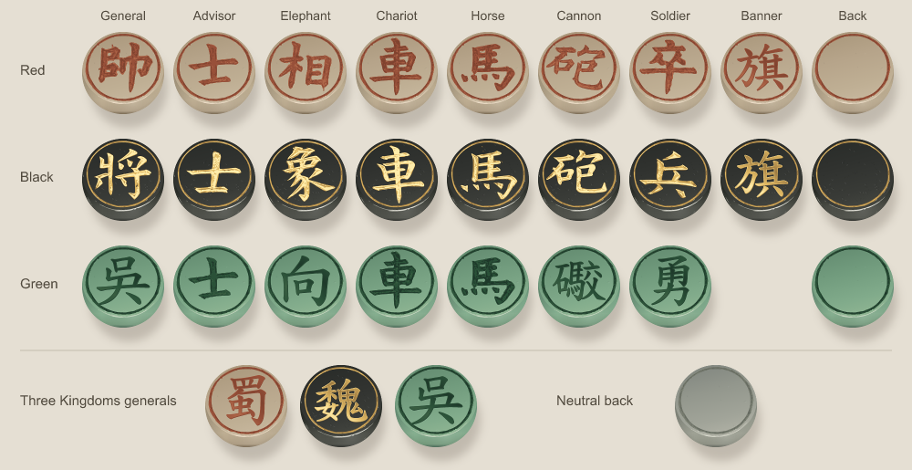

# Qing Jade

Qing Jade is a traditional piece set in the shared board catalog. The website ships 29 standalone SVGs. Each has a 100-unit canvas, a 90-unit circular body and a transparent gutter for the board renderer’s shadow and lift animation.



## Reference and artwork

The model is *Jade Chinese chess pieces*, National Palace Museum, Taipei, object 故玉006246N000000000. The unboxed photograph shows the inscriptions and the narrow reflection at the face-to-sidewall bevel. The two standard armies preserve the museum’s red 卒, gold 兵, shared 士 and stone-radical 砲. [Collection record](https://digitalarchive.npm.gov.tw/opendata/Pub/DetailEng/2465?dep=U&mode=full) · [Reference photograph, CC BY 4.0](https://iiifod.npm.gov.tw/iiif/2/K1C%2FK1C006246N000000000PAC/full/full/0/default.jpg)

The 3053 × 2293 reference plate has SHA-256 `3745b16813bc76f1767419fdc0d42ae71a8541fa27c9601099b684fdde94cde7`. Each inscription was aligned by its engraved ring. Separate pigment, gold facet, stone grain and polished-edge masks were traced to Bézier paths with Potrace 1.16. The vector master keeps each layer editable. The generator supplies the depth and face gradients, places the traced rings and applies each ink palette. [Vector master](../../../bin/gen/qing-jade/carvings.svg) · [Generator](../../../bin/gen/qing-jade/generate.mjs)

The photographs show two armies face up. LiXiangQi extends the design with unlettered backs, a celadon army for Wu and 旗 banners for Manchu. The new inscriptions use the repository’s TW-Kai outlines, fitted to the photographed writing area. Three Kingdoms uses 蜀, 魏 and 吳 for its generals. [Outline attribution](../three-kingdoms-pieces.md#outline-authoring-and-attribution)

## Regeneration and release

```sh
node bin/gen/qing-jade/generate.mjs
node bin/gen/qing-jade/generate.mjs --check
```

Deploy the website’s compiled assets and server catalog together. Both Flutter apps bundle the 14 Standard Xiangqi faces and two side-specific backs using their existing board snapshot workflow. Each app needs a new release for its picker to offer Qing Jade. Variant artwork belongs to the website while the mobile variants project is deferred.

The production asset build includes all 29 SVGs. Verification covered 786 UI tests, 23 Scala preference tests and rendering in Chromium and Firefox at 320, 768 and 1440 CSS pixels. The native picker tests saved Qing Jade in the main app and the Kids garden. Both native snapshots matched their 163 source assets and catalog.
