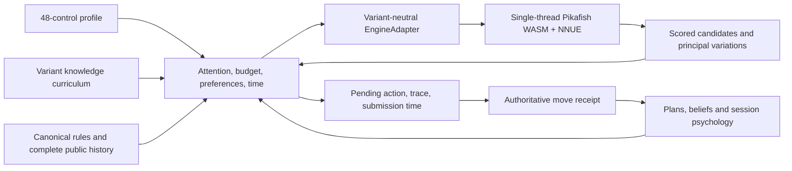

# Human-like bot framework

Standalone browser-first bot, model `engine-deliberation-3`. Pikafish supplies
live search and evaluation. All **48 human controls** remain configurable; the
previous homemade search tree has been removed. This follows the user's updated
request for engine-informed play, superseding the proposal's engine-free policy.
There is no LiXiangQi matchmaking, rating, account or production integration.

The nominal profile is a design reference, not a measured average person. The
advanced profile is a strong-search configuration, not an Elo claim. Human
indistinguishability and population calibration require human-game data and
controlled evaluation that this package does not yet have.

- [All 48 controls and their algorithms](CONTROLS.md)
- [Measured qualification and remaining limits](QUALIFICATION.md)
- [Public runtime contracts](src/types.ts)
- [Browser host and executable smoke test](../../tools/human-bot/browser.mjs)

## Architecture



The framework has three independent extension points:

1. `RulesAdapter` supplies public observations, legal actions, complete relevant
   history, chance outcomes and adjudication. Standard xiangqi compiles the
   existing Scala rules to JavaScript, including Tiantian repetition/chase rules,
   cannon screens, horse legs, elephant eyes and stalemate wins. There is no
   duplicate TypeScript move generator.
2. `KnowledgePack` describes recognizable ideas, opening recall, attention cues,
   plan progress, and subjective style features. It cannot call the engine or
   inspect private state. These features describe personality; they do not replace
   the engine's position evaluation.
3. `EngineAdapter` supplies bounded analysis with explicit utilities for **every
   player**. The core does not assume centipawns, negamax, two players or perfect
   information. Xiangqi's adapter converts Pikafish scores into decision units
   (100 cp = one unit), maps coordinates, replays public history, and validates
   returned variations against canonical rules. Future Jieqi/three-kingdoms
   adapters must supply information-set-safe analysis; standard Pikafish is not
   presented as an implementation of those variants.

The UCI parser is reused from `ui/lib/src/ceval/engines/pikafishProtocol.ts`.
Standalone hosting does not depend on site globals or server-side rules endpoints.
The Python player's Node backend runs the same WASM engine and policy as browsers.
The separate native oracle in the laboratory is only a diagnostic scorer.

## One decision

A turn performs bounded curriculum retrieval and relation inspection, followed by
**at most three engine calls**:

1. A shallow survey of the complete legal root. Authored ideas nominate candidates;
   progressively more engine discoveries enter the pool as capacity and curriculum
   mastery increase. Even the weakest configuration receives scored engine evidence.
2. Verification spends the remaining main budget on the admitted pool. At maximum
   capacity with a fully proceduralized curriculum, **every legal root remains
   eligible**. No handmade candidate filter limits that profile's playing ceiling.
3. A small optional reply survey for the leading candidate supplies expectations,
   surprise, practical-trap evidence and conditional forecasts. Main move values
   already include adversarial engine search; opponent personality does not replace
   that search with random replies.

The engine searches internally over far more moves than the few lines exposed to
human attention. `C03` controls explicit reply awareness, not Pikafish's internal
branching factor. `K03` controls access, recognition and use of ideas; it does not
literally erase concepts from NNUE. This is a deliberate hybrid, not a simulation
of a cognitively restricted chess engine.

Choice first establishes a skill-dependent quality envelope, then uses personality
within it. In the advanced profile the envelope is 0.08 decision units (8 cp).
That is a bound against the **available analysis**, not a guarantee against a
stronger oracle. Known forced outcomes dominate finite style preferences. The
only explicit exception is opt-in experimental motor slips (`E07`); the intended
and executed actions are both recorded. No arbitrary blunder probability is used.

Node/time stops can interrupt a MultiPV iteration. A newer scored final best move
is preserved without mixing scores from different iterations. If the final move
has no published comparable score, the adapter retains the last completed scored
set, increases uncertainty and records `unscoredBest` in the trace. It never
invents a score. Fewer style alternatives may be available. No scored evidence,
illegal output and runtime failures are explicit errors; there is no fallback to
the removed handmade evaluator.

## Resources and time

`C01` proposes 2,048–131,072 nodes per decision (16,384 at nominal capacity), shared
across all three searches. The default host envelope is 131,072 nodes, 2,000 ms of
analysis scheduling, six root PVs, four reply PVs, 64 beliefs, and bounded retained
line detail. Pikafish's node limit can overshoot by a polling batch; actual counts
are charged before another search. A stop command and a one-second acknowledgement
watchdog bound a stalled engine. Canonical PV validation and scheduler latency can
extend elapsed time beyond the nominal two-second search budget; the authoritative
chess clock remains the final deadline.

The human layer does no recursive game-tree search. It inspects at most 32 schema
bindings and 12 relations, and describes only the scored candidate set. Exact
restoration caches one real history prefix. Engine hash entries are reused within
a game; the lab clears engine state between independent samples. A population of
1,000 profiles is data, not 1,000 resident engines: hosts allocate a worker only for
an active game and release it when finished.

Thinking time comes from retrieval, inspection, verification, familiarity,
uncertainty, surprise and temporary psychology. It is separate from CPU work.
Submission waits only until the later of that planned time and actual completion;
engine time is not added again as an artificial delay. Future increment is never
spent before receipt. Opponent preparation rehearses already discovered PVs only
after real observed waiting; it does not run an unbounded background search.

The official compressed NNUE weighs 50,706,378 bytes. The same full network and
search are retained. Streaming decompression reduced this host's observed WASM
heap from about 461 MiB to 320 MiB. The JS download buffer, compiled rules and browser
runtime add memory beyond that number. This is **not qualified for low-memory
phones**. Physical iOS/Android testing remains necessary; desktop viewport and CPU
emulation are not device testing. A genuinely smaller evaluator would require a
separately trained/validated network or different engine adapter.

## Browser host

Serve over HTTPS or localhost, with these headers on the document and workers:

```text
Cross-Origin-Opener-Policy: same-origin
Cross-Origin-Embedder-Policy: require-corp
```

Serve WASM as `application/wasm`. Keep engine assets same-origin or configure the
required CORS/CORP responses. The current Emscripten build requires shared memory
and WASM SIMD even with one search thread. Initialization fails clearly if isolation
is missing. Initialize before starting game clocks; cache content-hashed engine
assets, and serve the unversioned entry/manifest with revalidation. The worker uses
SHA-256 verification of the pinned NNUE and content-versioned URLs.

```js
import { BotWorkerClient } from './dist/index.js';
import { xiangqiProfileSpec } from './dist/xiangqi.js';
const bot = new BotWorkerClient(new Worker('./dist/worker.js', { type: 'module' }));
await bot.call({
  id: 'init', kind: 'init', game: 'game-1',
  profile: xiangqiProfileSpec('advanced', 'player-42'),
  engineBaseUrl: '/pikafish-web/',
}, { timeoutMs: 60000 });
// decide -> honor pending.submitAt -> authoritative move -> accept
// Persist snapshot() atomically with that receipt. See browser.mjs for the protocol.
// AbortSignal or close() terminates the worker, including active work.
bot.close();
```

`BotSession.propose` is asynchronous. Concurrent identical proposals share one
search; pending retries and restored pending receipts do not reroll or reanalyze.
Acceptance validates the exact before/after transition and deadline before
advancing memory. Cancellation cannot install a late result. Cached pending
analysis is pinned to the engine build. A cancelled native search closes that
engine; recreate it before reuse. Host messages must use consistent clock epochs;
the browser host uses epoch timestamps plus monotonic elapsed runtime.

## Build and verify

Node 24, repository pnpm 11 dependencies, Java 21/SBT, and the pinned network are
required. The native oracle is only needed for diagnostic comparisons.

```text
pnpm install
python scripts/pikafish/install.py --browser-dir public/pikafish-web
node tools/human-bot/build.mjs
node ui/.test/runner.mjs humanBot
node --import tsx --test tools/human-bot/integration.test.ts
node tools/human-bot/browser.mjs browser-results.json
node --import tsx tools/human-bot/lab.ts --oracle --sweep --games 2 --out lab-results.json
```

Set `BROWSER=firefox` or `BROWSER=webkit` for the other browser runs. Set `PYTHON`
for the offline oracle if the default interpreter is unavailable. `--skip-rules`
only reuses the ScalaJS build when its source and binary hashes still match.
The framework build writes an engine manifest tying the runtime to the release,
WASM digest and NNUE digest. Preserve `NOTICE.html`, GPL sources/licenses, and the
network's separate terms when distributing engine assets. See
[the maintained engine build](../../scripts/pikafish-web/README.md).

Version-1/2 profiles are rejected rather than silently reinterpreted. Their 48
values can be deliberately copied into a newly versioned profile, but resulting
strength must be recalibrated. The outside-repository desktop player supplies new
nominal/advanced JSON files and leaves old personal files untouched.
